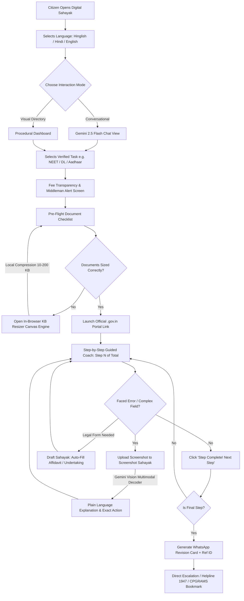
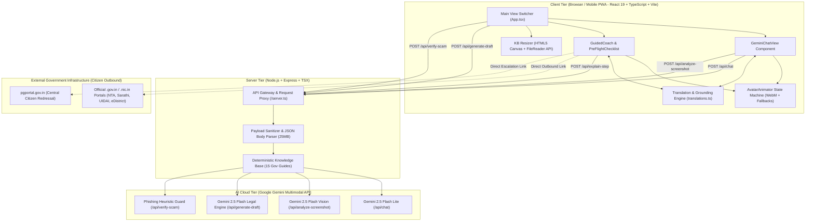

# THE CORPORATE GLITCH ’26 — NATIONAL LEVEL HACKATHON
## Builders Hub — Track: Open Innovation / Citizen Tech / AI for Bharat
### Final Product Pitch & Technical Architecture Blueprint

---

```
  ____  _       _ _        _   ____        _             _           _    
 |  _ \(_) __ _(_) |_ __ _| | / ___|  __ _| |__   __ _  (_) __ _ | | __
 | | | | |/ _` | | __/ _` | | \___ \ / _` | '_ \ / _` | | |/ _` | |/ /
 | |_| | | (_| | | || (_| | |  ___) | (_| | | | | (_| | | | (_| |   < 
 |____/|_|\__, |_|\__\__,_|_| |____/ \__,_|_| |_|\__,_| _/ |\__,_|_|\_\
          |___/                                        |__/            
 Unified Citizen Grievances & Direct System Navigator for Digital India
```

---

# SLIDE 1: COVER PAGE

### 1. Slide Content (Ready to Paste)
* **Title:** **Digital Sahayak** (डिजिटल सहायक)
* **Subtitle:** Unified Citizen Grievances & Direct System Navigator — Eliminating the Middleman Tax on 100% of `.gov.in` Citizen Services
* **Problem Statement:** Eliminating predatory cyber cafe tout charges, privacy leaks, and portal rejection barriers for 450M+ mobile-first Indian citizens through grounded multimodal AI guidance.
* **Team Name:** [Insert Team Name — e.g., Team Builders Hub / Team Sahayak]
* **Track:** Open Innovation / Citizen Empowerment / Generative AI
* **Team Members:** Utkarsh Srivastava, Mishu, [Insert Team Member 3], [Insert Team Member 4]
* **College / Institution:** [Insert College / Institution Name]
* **Hackathon:** THE CORPORATE GLITCH ’26 — National Level Hackathon

---

### 2. Deep-Dive Project Details
* **App Identity & Core Mission:** Digital Sahayak is a production-ready, client-grounded web application designed to guide Indian citizens step-by-step through complex government portals (`.gov.in` and `.nic.in`) from their personal mobile devices without visiting cyber cafes or paying illegal middlemen fees.
* **Language Support Matrix:** Full tri-lingual state reactivity across:
  * **Hinglish** (Phonetic Roman Hindi + conversational English — the lingua franca of 400M+ smartphone users in Tier 2/3 cities).
  * **Simple Hindi (सरल हिंदी)** (Pure Devanagari script designed for first-time rural internet users).
  * **Simple English** (Plain-language administrative English free of legal jargon).
* **Target Audience:** Students applying for entrance examinations (NEET, JEE), daily wage earners, rural landowners checking Bhulekh land records, citizens renewing driving licences, elderly citizens updating Aadhaar biometrics, and aggrieved citizens filing CPGRAMS central grievances.

---

### 3. Visual / Diagram Blueprint
```
+--------------------------------------------------------------------------------------------------+
|                                    THE CORPORATE GLITCH '26                                      |
|                                                                                                  |
|       🇮🇳 DIGITAL SAHAYAK (डिजिटल सहायक)                                                          |
|       Democratizing Government Portals: Zero Middlemen, Zero Hallucinations                      |
|                                                                                                  |
|   [ Avatar Animator: State 1 - Namaste / Wave ]       [ Live Demo Badges ]                       |
|   • Multimodal Gemini 2.5 Flash Engine                • 15 Verified .gov.in Guides               |
|   • Client-Side HTML5 Canvas Resizer                  • 100% Free Public Interest                |
|   • Real-Time WhatsApp Phishing Shield                • Zero Server-Side File Storage            |
|                                                                                                  |
|   Team: Utkarsh Srivastava, Mishu | College: [Your College Name] | Date: 2026                    |
+--------------------------------------------------------------------------------------------------+
```

---

# SLIDE 2: PROBLEM STATEMENT

### 1. Slide Content (Ready to Paste)
* **The "Middleman Tax" Crisis:** Over 450 Million Indian citizens with smartphones still queue outside unauthorized cyber cafes and RTO/tehsil tout kiosks for routine government forms, losing ₹300 to ₹3,000 in extortionate agent fees per application.
* **Systemic Exploitation Points:**
  * **Predatory Pricing:** Citizens pay 5x–10x the statutory fee (e.g., ₹1,500 charged for a ₹50 Aadhaar update; ₹3,500 charged for a ₹1,100 Gazette name change; ₹500 charged for free land records).
  * **Catastrophic Operator Typos:** Kiosk operators rush through dozens of forms daily, creating spelling mistakes in Aadhaar, DOB, and category certificates that take months or years of court affidavits to rectify.
  * **Digital Hostage-Taking:** Cyber cafes retain portal passwords, application numbers, and registered mobile numbers, forcing applicants to return and pay for every subsequent admit card, receipt, or status download.
  * **Arbitrary Tech Rejections:** Portals strictly enforce obscure limits (e.g., NEET photo 10–200 KB, signature 10–100 KB, black-ink only, 80% face visibility) without explaining how to resize files on mobile phones.
  * **Rampant Phishing & Cyber Fraud:** Indians lost over ₹7,488 Crore in 2023 to fake WhatsApp scheme links (e.g., "Free PM Solar Yojana", "Electricity KYC disconnection APKs").

---

### 2. Deep-Dive Project Details
#### Actual Real-World Fee Contrasts (Extracted from Digital Sahayak Knowledge Base)
| Government Service | Official Statutory Fee | Cyber Cafe / Tout Charge | Middleman Markup | Real-World Citizen Consequence |
|:---|:---:|:---:|:---:|:---|
| **NEET UG 2025 Application** | ₹1,700 (Gen) / ₹1,000 (SC) | ₹2,100 – ₹3,500 | +₹400 to +₹1,800 | Phony "guaranteed confirmation" promises; wrong exam cities selected. |
| **Driving Licence Renewal (Parivahan)** | ₹200 – ₹400 | ₹1,000 – ₹1,800 | +₹800 to +₹1,400 | Touts hide that Aadhaar contactless service posts the DL straight home. |
| **Aadhaar Mobile Number Update** | ₹50 (UIDAI Fixed) | ₹200 – ₹500 | **+400% to +1000%** | Biometric centers charge cash illegal commissions under threat of fake delays. |
| **Gazette Name Change (Bharatkosh)** | ₹1,100 (Statutory) | ₹5,000 – ₹15,000 | **+450% to +1360%** | Legal "consultants" charge exorbitant fees for basic MS Word proformas. |
| **Fresh Aadhaar Enrolment** | **₹0 (100% Free)** | ₹150 – ₹300 | **Infinite Markup** | Poor families charged cash for a statutorily free fundamental identity. |
| **UP / Delhi Bhulekh (Land Records)** | **₹0 (100% Free)** | ₹200 – ₹500 | **Infinite Markup** | Farmers pay just to view their own Khatoni/Khasra agricultural land records. |
| **CPGRAMS Public Grievance** | **₹0 (Citizen Right)** | ₹500 – ₹1,500 | **Infinite Markup** | Touts convince citizens that filing an administrative delay complaint requires a lawyer. |

---

### 3. Visual / Diagram Blueprint
```
+---------------------------------------------------------------------------------------------------+
|                                 THE MIDDLEMAN TAX SPIRAL (WHY IT MATTERS)                         |
|                                                                                                   |
|  [CITIZEN SMARTPHONE]                               [CYBER CAFE / TOUT TRAP]                      |
|  • 800M+ Internet Connections                       • ₹300 to ₹3,000 Illegal Markups              |
|  • High-Speed 4G/5G Coverage                        • Plaintext ID / Password Lock-In             |
|  • UPI-Ready Bank Accounts                          • Rushed Typos on DOB / Caste                 |
|          │                                                   │                                    |
|          ▼                                                   ▼                                    |
|  [THE INTIMIDATION BARRIER]                          [CITIZEN DAMAGE]                             |
|  • Cryptic Portal Errors ("HTTP 500", "Object Ref")  • Financial Drain on Low-Income Families     |
|  • Strict File Limits (10-200 KB Image Uploads)      • Disqualified Exam Applications             |
|  • Legal Jargon ("Deponent", "Proforma", "ROR")      • Identity Theft via Stored Documents        |
+---------------------------------------------------------------------------------------------------+
```

---

# SLIDE 3: SOLUTION

### 1. Slide Content (Ready to Paste)
* **Digital Sahayak in One Sentence:** An active, zero-cost, multimodal copilot that empowers every Indian citizen to successfully complete official `.gov.in` procedures directly on their mobile browser with zero middleman assistance and zero hallucinations.
* **The 4 Pillars of Direct Citizen Self-Reliance:**
  1. **Strictly Grounded Official Workflow Routing:** Bypasses search-engine ads and fake phishing portals; locks citizens exclusively onto authentic `.gov.in` / `.nic.in` URLs with active middleman fraud alerts.
  2. **Client-Side Pre-Flight Checklists & KB Resizer:** Verifies all statutory requirements upfront; compresses photos and signatures to exact portal specifications in-browser (zero cloud uploads, 100% privacy).
  3. **One-Step-At-A-Time Guided Coaching:** Breaks 20-page confusing government portals into single, digestible micro-steps in Hinglish/Hindi/English with "Aasaan Matlab" everyday translations for legal jargon.
  4. **Direct Escalation & Legal Draft Sahayak:** Auto-generates formal affidavits, RTI-backed undertakings, and CPGRAMS central grievances with automated WhatsApp revision cards upon completion.

---

### 2. Deep-Dive Project Details
* **Active Copilot Paradigm (Prep -> Fill -> Escalate):**
  Unlike generic chatbots that output overwhelming 2,000-word walls of text, Digital Sahayak enforces an interactive turn-by-turn workflow:
  * **Screen A (Readiness & Fee Transparency):** Compares Official Fee vs. Cyber Cafe markup in big bold numbers, showing exact citizen savings before a single form is touched.
  * **Screen B (Document Pre-Flight):** An interactive checklist verifying required documents, active Aadhaar mobile OTP links, and photo dimensions.
  * **Screen C (Guided Coach Stepper):** Renders the active step instruction, detailed walkthrough, and "💡 Tough Terms (Aasaan Matlab)" accordion (e.g., explaining that *Deponent* means *Aapka naam*, or *ROR* means *Khatoni nakal*).
  * **Screen D (Multimodal Error Decoder):** Citizens take a photo or screenshot of any portal error; the vision model decodes the cryptic server error and explains the fix in plain conversational language.
  * **Screen E (Statutory Application Card & WhatsApp Summary):** Generates a formatted summary card with temporary reference numbers and direct links to official helpline 1947 or CPGRAMS.

---

### 3. Visual / Diagram Blueprint
```
+---------------------------------------------------------------------------------------------------+
|                                 DIGITAL SAHAYAK SOLUTION SUITE                                    |
|                                                                                                   |
|  [ 1. TRUST ENGINE ]        [ 2. ON-DEVICE UTILITY ]   [ 3. GUIDED STEPPER ]   [ 4. SAFETY NET ]  |
|  • Zero Tout Guarantee      • Client-Side KB Resizer   • Micro-Step Workflow   • Scam Shield      |
|  • Verified Portal Links    • 10-200 KB Canvas Engine  • "Aasaan Matlab" Terms • CPGRAMS Escalator|
|  • Fee Transparency Box     • Zero-Cloud Photo Privacy • Interactive Progress • Legal Drafts     |
+---------------------------------------------------------------------------------------------------+
```

---

# SLIDE 4: FLOW OF SOLUTION (ARCHITECTURE & WORKFLOW)

### 1. Slide Content (Ready to Paste)
* **End-to-End Citizen Journey:**
  1. **Discovery & Language Selection:** Citizen picks preferred language (Hinglish / हिंदी / English); toggles light/dark mode.
  2. **Procedure Selection & Fee Transparency:** Selects from 15 Central & State procedures; reviews statutory fee and calculated savings.
  3. **Pre-Flight Verification:** Checks required IDs; resizes photos/signatures on-device to statutory KB limits with one click.
  4. **Turn-by-Turn Guided Execution:** Follows micro-steps; uploads error screenshots if stuck; generates ready legal affidavits.
  5. **Completion & Revision Card:** Copies WhatsApp summary card with application ID and tracking bookmark.

---

### 2. Deep-Dive Project Details (Mermaid.js Flowcharts)

#### A. User Journey Workflow Flowchart


---

#### B. System Architecture Diagram


---

# SLIDE 5: TECH STACK & IMPLEMENTATION APPROACH

### 1. Slide Content (Ready to Paste)
* **Frontend Architecture:** React 19 (`react: ^19.0.1`), TypeScript (`typescript: ^7.0.2`), Vite 6 (`vite: ^8.3.0`), Tailwind CSS v4 (`@tailwindcss/vite: ^4.3.3`), Lucide React icons, and Motion (`motion: ^12.23.24`).
* **AI & Multimodal Engine:** Google Gen AI SDK (`@google/genai: ^2.4.0`), utilizing `gemini-2.5-flash` for vision error analysis and `gemini-2.5-flash-lite` for conversational assistance.
* **Client-Side Image Manipulation:** HTML5 `<canvas>` and browser `FileReader` API for zero-server compression and resizing.
* **Backend Proxy & Middleware:** Express (`express: ^4.21.2`), `dotenv`, and `tsx` runtime for zero-exposure API key protection and secure server-side grounding.
* **Core Engineering Principles:**
  * **Strict Grounding (Zero Hallucination):** System prompt hard-locks models to 15 verified `.gov.in` procedure specifications.
  * **Zero-Server-Storage Privacy:** Citizen photos, signatures, and identity proofs are manipulated 100% in local memory.
  * **Adaptive Avatar State Machine:** Seamless 4-state video/static transitions (`greeting`, `thinking`, `answering`, `pointing`, `idle`).

---

### 2. Deep-Dive Project Details
#### Component & File Mapping (From Actual Codebase)
* `/server.ts`:
  * Implements `GoogleGenAI` initialization via server-side proxy route `/api/chat`.
  * Houses the 1,300+ line verified knowledge base containing exact fees, document specifications, and step-by-step procedures.
  * Implements multimodal vision endpoint `/api/analyze-screenshot` with base64 image parsing.
  * Implements `/api/verify-scam` phishing heuristic validator.
  * Implements `/api/generate-draft` legal proforma template compiler.
* `/src/components/AvatarAnimator.tsx`:
  * Handles smooth video-to-static state switching using WebM assets (`1-hi.webm`, `2-thinking-bulb.webm`, `3-thinking.webm`, `4-pointing.webm`) with automatic fallback to `idle.png`.
  * Features auto-reset on completion and looping while `isLoading === true`.
* `/src/components/KbResizer.tsx`:
  * Runs iterative canvas scaling (`maxDim = 1200`, binary quality step-down `0.85 -> 0.20`).
  * Delivers exact target KB limits (85 KB for NEET, 45 KB for Signatures, 180 KB for PDFs) entirely on client hardware.
* `/src/utils/translations.ts`:
  * Comprehensive typed translation matrix (`Language = 'hinglish' | 'hi' | 'en'`) covering every procedure, UI button, and fee transparency card.
* `/src/utils/procedures.ts`:
  * Defines data interfaces `Procedure`, `StepInfo`, `ChecklistItem`, and `ToughTerm`.
  * Provides statutory SLA tracking and algorithmic direct savings calculations.

---

### 3. Visual / Diagram Blueprint
```
+---------------------------------------------------------------------------------------------------+
|                                  TECH STACK ARCHITECTURE MATRIX                                   |
|                                                                                                   |
|  [ FRONTEND LAYER ]            [ COMPLIANCE & PRIVACY ]          [ BACKEND & MULTIMODAL AI ]      |
|  • React 19 + TypeScript       • Local In-Browser Processing     • Node.js / Express Proxy        |
|  • Tailwind CSS v4             • HTML5 Canvas Image Engine       • Google @google/genai SDK       |
|  • Vite 6 + Motion Engine      • Zero Cloud Photo Storage        • Gemini 2.5 Flash (Vision)      |
|  • Lucide React Icons          • Zero Citizen PII Retention      • Gemini 2.5 Flash Lite (Chat)   |
|  • 4-State WebM Avatar Engine  • 100% Client-Side FileReader     • Low-Temp (0.2) Determinism     |
+---------------------------------------------------------------------------------------------------+
```

---

# SLIDE 6: UNIQUE SELLING PROPOSITION (USP) & KEY FEATURES

### 1. Slide Content (Ready to Paste)
1. **Error Screenshot Sahayak (Multimodal Vision Decoder):**
   * Eliminates the #1 reason citizens give up: cryptic portal error codes ("HTTP 500", "Object reference not set", "File format mismatch").
   * Citizens upload an error photo; Gemini 2.5 Flash decodes the image in under 2 seconds, explaining the root cause and the exact single click needed to fix it.
2. **On-Device Zero-Leak KB Resizer:**
   * Solves upload rejections by resizing photos and signatures to strict government limits (10–200 KB) in the browser.
   * **100% Privacy Guarantee:** User photos and signatures NEVER leave the citizen's device.
3. **Draft Sahayak (AI Legal Proforma Generator):**
   * Automatically formats court-acceptable name change affidavits, spelling correction undertakings, and CPGRAMS complaints with one click.
4. **Scam Shield (स्कैम कवच):**
   * Real-time anti-phishing scanner that detects fake scheme links (e.g., fraudulent "PM Solar Yojana" WhatsApp broadcasts) before citizens lose money.
5. **Interactive Animated Sahayak (State Machine Guide):**
   * Humanizes technology for first-time internet users through reactive animated character states: waving on arrival, thinking while calculating, pointing to form buttons, and smiling when complete.

---

### 2. Deep-Dive Project Details
#### Feature Matrix & Code Highlights
* **Multimodal Vision Prompting (`/api/analyze-screenshot` in `server.ts`):**
  Uses structured system instructions with image parts:
  ```typescript
  // Actual prompt architecture from server.ts
  contents: [
    { text: `Analyze this portal screenshot for ${taskTitle}. Explain what the error or form field means in simple conversational ${language}. Give 1 clear action.` },
    { inlineData: { mimeType: 'image/jpeg', data: base64Clean } }
  ]
  ```
* **In-Browser Compression Algorithm (`KbResizer.tsx`):**
  ```typescript
  // Client-side execution without server transmission
  let compressedDataUrl = canvas.toDataURL('image/jpeg', quality);
  let approxKb = Math.round((compressedDataUrl.length * 3) / 4 / 1024);
  if (approxKb > targetKb && quality > 0.3) {
    quality = Math.max(0.2, (targetKb / approxKb) * quality);
    compressedDataUrl = canvas.toDataURL('image/jpeg', quality);
  }
  ```
* **Scam Shield Database (`/api/verify-scam` in `server.ts`):**
  Hardened heuristic engine checking against known malicious TLDs (`.xyz`, `.top`, `.free-apk.in`) and validating against genuine `.gov.in` and `.nic.in` domains.

---

### 3. Visual / Diagram Blueprint
```
+---------------------------------------------------------------------------------------------------+
|                                 5 PILLARS OF COMPETITIVE ADVANTAGE                                |
|                                                                                                   |
|  [ 📸 SCREENSHOT SAHAYAK ] ──> Multi-modal vision decodes cryptic portal errors in Hinglish.       |
|  [ ⚡ ON-DEVICE RESIZER ]  ──> HTML5 Canvas scales photos to 10-200 KB with ZERO server upload.   |
|  [ 📝 DRAFT SAHAYAK ]      ──> Auto-generates court affidavits and CPGRAMS grievance complaints.  |
|  [ 🛡️ SCAM SHIELD ]        ──> Real-time phishing defense against WhatsApp fraud schemes.         |
|  [ 🎭 ANIMATED AVATAR ]    ──> Welcoming 4-state WebM character removes intimidation for rural UI. |
+---------------------------------------------------------------------------------------------------+
```

---

# SLIDE 7: FEASIBILITY & COMPETITORS

### 1. Slide Content (Ready to Paste)
* **Technical Feasibility:** 100% web-standards based; requires zero app installation; operates smoothly on low-end ₹6,000 Android phones over 3G/4G networks; near-instant load times (<1.2s).
* **Operational Feasibility:** Requires **ZERO changes** to government portals or APIs; sits alongside existing portals as an empowering citizen copilot.
* **Economic Viability:** Negligible server compute. Image resizing is offloaded to client hardware; uses lightweight, cost-effective Gemini 2.5 Flash Lite tokens costing <₹0.04 per citizen workflow.
* **Expected Challenges & Built-in Mitigations:**
  * *Challenge 1: Portal UI Changes* -> **Mitigation:** Multimodal vision dynamically reads live screens rather than relying on brittle hardcoded XPath selectors.
  * *Challenge 2: Low Rural Bandwidth* -> **Mitigation:** Zero image uploading for resizing; lightweight UI assets with WebM compression and SVG icons.
  * *Challenge 3: Citizen Trust* -> **Mitigation:** Strict non-custodial architecture (never asks for passwords or banking pins; routes to official `.gov.in` URLs).

---

### 2. Deep-Dive Project Details: Competitor Comparison Table
| Feature / Parameter | Cyber Cafes / Touts | Official Portals (UMANG) | YouTube Tutorials | Generic AI (ChatGPT / CoPilot) | **Digital Sahayak (Our Solution)** |
|:---|:---:|:---:|:---:|:---:|:---:|
| **Cost to Citizen** | ₹300 – ₹3,000 Markup | Free | Free (ad-supported) | Free / $20/mo | **100% Free Self-Service** |
| **Privacy & Security** | ❌ High risk (operators keep passwords & Aadhaar) | ✅ High (Government hosted) | ⚠️ Public video; user fills alone | ❌ PII uploaded to third-party cloud | **✅ 100% Private (On-device file processing)** |
| **Live Error Screenshot Help** | ⚠️ Operator guesses or charges extra | ❌ Static FAQs only | ❌ None (pre-recorded video) | ⚠️ Hallucinates non-existent gov steps | **✅ Real-time Multimodal Vision Decoder** |
| **Document KB Resizer** | ⚠️ Operator uses unknown software | ❌ Rejected on upload failure | ❌ None | ❌ Cannot compress or export files | **✅ Built-in HTML5 Canvas Resizer** |
| **Hallucination Protection** | ❌ Touts lie about requirements | N/A | ⚠️ Often outdated videos | ❌ High risk of fake URLs / fees | **✅ Strictly Grounded in 15 Gov Guides** |
| **Language Accessibility** | ⚠️ Dependent on operator patience | ⚠️ Complex formal Hindi/English | ⚠️ Hindi/Regional | ⚠️ Overly verbose English/Hindi | **✅ Native Hinglish + Simple Hindi + English** |
| **Escalation & Legal Drafts** | ❌ Charges ₹1,000+ for fake affidavits | ❌ No legal drafting | ❌ None | ⚠️ Generic unformatted text | **✅ One-click CPGRAMS & Gazette Drafts** |

---

### 3. Visual / Diagram Blueprint
```
+---------------------------------------------------------------------------------------------------+
|                                  COMPETITIVE POSITIONING MATRIX                                   |
|                                                                                                   |
|    High Guidance ▲                                                                                |
|                  │                                              ★ DIGITAL SAHAYAK                 |
|                  │                                       (Multimodal, Grounded, Free,              |
|                  │                                        Client-Side Prep, Tri-Lingual)          |
|                  │             CYBER CAFES / TOUTS                                                |
|                  │             (Expensive, Privacy Risk,                                          |
|                  │              High Friction)                                                    |
|                  │                                                                                |
|                  │                                    GENERIC AI (ChatGPT)                        |
|                  │                                    (Hallucinates URLs, No Resizer,             |
|                  │                                     No Grounding)                              |
|                  │                                                                                |
|                  │   YOUTUBE TUTORIALS          OFFICIAL PORTALS (UMANG)                          |
|                  │   (Outdated, Passive Video)  (Cluttered, Static FAQs,                           |
|                  │                               No Live Error Help)                              |
|                  └─────────────────────────────────────────────────────────────►                  |
|                  Low Trust / Privacy                               High Trust / Zero Cost         |
+---------------------------------------------------------------------------------------------------+
```

---

# SLIDE 8: RESEARCH & REFERENCE

### 1. Slide Content (Ready to Paste)
* **Authoritative Knowledge Base Grounding:** Digital Sahayak is grounded in official citizen charters, gazette rules, and verified statutory procedures from:
  1. **National Testing Agency (NTA):** `neet.nta.nic.in` & `exams.nta.ac.in`
  2. **Ministry of Road Transport and Highways (MoRTH):** `sarathi.parivahan.gov.in`
  3. **Unique Identification Authority of India (UIDAI):** `uidai.gov.in` & `myaadhaar.uidai.gov.in`
  4. **Department of Publication (Ministry of Housing & Urban Affairs):** `egazette.gov.in` & `bharatkosh.gov.in`
  5. **Indian Space Research Organisation (ISRO):** `bhuvan.nrsc.gov.in/aadhaar`
  6. **Ministry of External Affairs (MEA):** `passportindia.gov.in`
  7. **Department of Administrative Reforms and Public Grievances (DARPG):** `pgportal.gov.in`
  8. **Central Vigilance Commission (CVC) & Lokpal:** `cvc.gov.in` & `lokpal.gov.in`
  9. **Ministry of Home Affairs (Foreigners Division):** `indiancitizenshiponline.nic.in`
  10. **Delhi Revenue Department (DLRC):** `dlrc.delhi.gov.in` & `edistrict.delhigovt.nic.in`
  11. **Board of Revenue Uttar Pradesh:** `upbhulekh.gov.in` & `esathi.up.gov.in`
* **National Statutory Helplines Integrated:**
  * National Identity Toll-Free Helpline: **1947**
  * National Cyber Crime Helpline: **1930**
  * NTA NEET Helpline: **011-40759000**
  * MEA Passport Seva Call Centre: **1800-258-1800**
* **Project Artifacts & Links:**
  * **GitHub Repository:** `[Insert GitHub Repo URL — e.g. https://github.com/your-team/digital-sahayak]`
  * **Live Deployed Prototype:** `[Insert Live Demo URL — e.g. https://ais-pre-6xlgb3pqnhgqlq3yabkvuw-868673671398.asia-southeast1.run.app]`
  * **Interactive Pitch Deck Deck Spec:** `file:///.aistudio/artifacts/brain/3f3e226a-cc57-4ad0-be34-de101649fed9/hackathon_pitch_deck.md`

---

### 2. Deep-Dive Project Details
* **Statutory Compliance & Legal Disclaimer:**
  Digital Sahayak operates strictly under the Fair Dealing provisions of public-interest civic guidance. It is an independent civic utility that does not collect credentials, does not charge citizens, and routes all official submissions directly to `.gov.in` / `.nic.in` servers. All trademarks, portals, and statutory logos belong to their respective government authorities.
* **Verification & Test Coverage:**
  The project features automated regression tests (`src/utils/procedures.test.ts`) validating savings calculations, keyword search indices, category filters, document readiness ratios, and WhatsApp revision card generation.

---

### 3. Visual / Diagram Blueprint
```
+---------------------------------------------------------------------------------------------------+
|                                 GOVERNMENT PORTALS & CITIZEN TRUST ECOSYSTEM                      |
|                                                                                                   |
|     [ CENTRAL SERVICES ]             [ DELHI NCT SERVICES ]           [ UTTAR PRADESH SERVICES ]  |
|   • NEET UG (NTA)                  • Land Records (DLRC)             • Bhulekh Land Records       |
|   • Parivahan Driving Licence      • Domicile Certificate            • eSathi Niwas Praman Patra  |
|   • UIDAI Aadhaar Mobile / Bio     • SC/ST/OBC Caste Certificate     • eSathi Jati Praman Patra   |
|   • Bharatkosh Gazette Name Change                                                                |
|   • MEA Passport / Tatkaal                                                                        |
|   • CPGRAMS Central Grievance                                                                     |
|   • CVC / Lokpal Anti-Corruption                                                                  |
|   • MHA Overseas Indian (OCI)                                                                     |
|                                                                                                   |
|               [ ALL ROADS LEAD DIRECTLY TO AUTHENTIC .GOV.IN & .NIC.IN ]                          |
+---------------------------------------------------------------------------------------------------+
```
